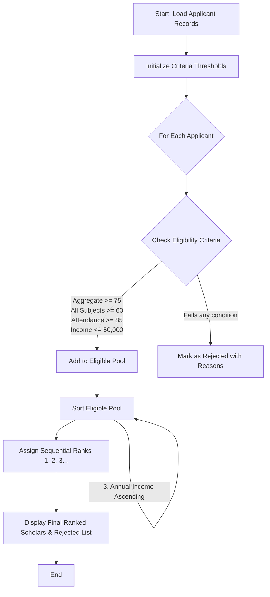

Here is the complete system design, algorithm, Mermaid flowchart, and Python implementation for the **University Scholarship Allocation System**.

---

### 1. Problem Statement

The university aims to automate its merit-cum-need scholarship allocation process. The system must evaluate student applicants based on four primary criteria:

1. **Aggregate Marks**: Must be $\ge$ 75.0%.
2. **Subject-wise Minimum Scores**: Every individual subject score must be $\ge$ 60.0.
3. **Attendance**: Must be $\ge$ 85.0%.
4. **Annual Family Income**: Must be $\le$ $50,000.

**Ranking & Tie-Resolution Rules:**
If multiple students pass the eligibility checks, they are ranked using the following hierarchical sorting rules:

1. **Primary Key**: Aggregate Marks (Descending — highest marks first).
2. **Secondary Key (Tie-breaker 1)**: Attendance (Descending — highest attendance first).
3. **Tertiary Key (Tie-breaker 2)**: Annual Family Income (Ascending — lower income given preference).

---

### 2. Algorithm

1. **Initialize Criteria Thresholds**: Set minimum aggregate (75.0), minimum subject mark (60.0), minimum attendance (85.0), and maximum income (50000).
2. **Input Data**: Read applicant details including ID, name, aggregate marks, list of subject marks, attendance percentage, and annual income.
3. **Filter Applicants (Eligibility Check)**:
* For each applicant, verify if:
* `Aggregate Marks` $\ge$ Threshold
* All elements in `Subject Marks` $\ge$ Threshold
* `Attendance` $\ge$ Threshold
* `Annual Income` $\le$ Threshold


* If all conditions are met, add to the **Eligible Pool**.
* Otherwise, mark as **Rejected** along with specific failure reasons.


4. **Sort Eligible Pool**:
* Sort applicants using a multi-key comparator:
* `-aggregate_marks` (Descending)
* `-attendance` (Descending)
* `annual_income` (Ascending)


5. **Assign Ranks**: Iterate through the sorted eligible list and assign sequential ranks starting from `1`.
6. **Output Results**: Display the ranked scholarship recipients and the rejected applicants with reasons.

---

### 3. Flowchart (Mermaid)



---

### 4. Python Source Code

```python
class ScholarshipSystem:

    def __init__(
        self,
        min_aggregate=75.0,
        min_subject_mark=60.0,
        min_attendance=85.0,
        max_income=50000,
    ):
        self.min_aggregate = min_aggregate
        self.min_subject_mark = min_subject_mark
        self.min_attendance = min_attendance
        self.max_income = max_income

    def evaluate_applicants(self, applicants):
        eligible = []
        rejected = []

        for app in applicants:
            # Criteria checks
            agg_ok = app["aggregate_marks"] >= self.min_aggregate
            subj_ok = all(
                m >= self.min_subject_mark for m in app["subject_marks"]
            )
            att_ok = app["attendance"] >= self.min_attendance
            inc_ok = app["annual_income"] <= self.max_income

            if agg_ok and subj_ok and att_ok and inc_ok:
                eligible.append(app)
            else:
                reasons = []
                if not agg_ok:
                    reasons.append(
                        f"Aggregate marks ({app['aggregate_marks']}%) below minimum ({self.min_aggregate}%)"
                    )
                if not subj_ok:
                    reasons.append(
                        f"One or more subject marks below minimum ({self.min_subject_mark})"
                    )
                if not att_ok:
                    reasons.append(
                        f"Attendance ({app['attendance']}%) below minimum ({self.min_attendance}%)"
                    )
                if not inc_ok:
                    reasons.append(
                        f"Income (${app['annual_income']}) exceeds maximum (${self.max_income})"
                    )
                app["reasons"] = "; ".join(reasons)
                rejected.append(app)

        # Sorting with multi-level tie-breakers:
        # 1. Highest aggregate marks first (-x['aggregate_marks'])
        # 2. Highest attendance first (-x['attendance'])
        # 3. Lowest income first (x['annual_income'])
        eligible.sort(
            key=lambda x: (
                -x["aggregate_marks"],
                -x["attendance"],
                x["annual_income"],
            )
        )

        # Assign Ranks
        for rank, app in enumerate(eligible, start=1):
            app["rank"] = rank

        return eligible, rejected


# --- Sample Execution ---
if __name__ == "__main__":
    system = ScholarshipSystem()

    applicants_data = [
        {
            "id": "A001",
            "name": "Alice Smith",
            "aggregate_marks": 88.5,
            "subject_marks": [85, 90, 82, 91],
            "attendance": 92.0,
            "annual_income": 42000,
        },
        {
            "id": "A002",
            "name": "Bob Jones",
            "aggregate_marks": 92.0,
            "subject_marks": [95, 88, 94, 91],
            "attendance": 89.0,
            "annual_income": 48000,
        },
        {
            "id": "A003",
            "name": "Charlie Brown",
            "aggregate_marks": 88.5,
            "subject_marks": [85, 90, 58, 91],  # Fails subject minimum (58)
            "attendance": 95.0,
            "annual_income": 35000,
        },
        {
            "id": "A004",
            "name": "Diana Prince",
            "aggregate_marks": 88.5,
            "subject_marks": [85, 90, 82, 91],
            "attendance": 92.0,
            "annual_income": 40000,  # Tie with Alice on marks & attendance, lower income resolves tie
        },
        {
            "id": "A005",
            "name": "Evan Wright",
            "aggregate_marks": 70.0,
            "subject_marks": [70, 70, 70, 70],  # Fails aggregate minimum (70.0)
            "attendance": 90.0,
            "annual_income": 30000,
        },
    ]

    eligible_list, rejected_list = system.evaluate_applicants(applicants_data)

    print("=== SCHOLARSHIP ALLOCATION RESULTS ===")
    print("\n--- ELIGIBLE & RANKED STUDENTS ---")
    for student in eligible_list:
        print(
            f"Rank {student['rank']}: {student['name']} (ID: {student['id']}) | "
            f"Aggregate: {student['aggregate_marks']}% | Attendance: {student['attendance']}% | "
            f"Income: ${student['annual_income']}"
        )

    print("\n--- REJECTED STUDENTS ---")
    for student in rejected_list:
        print(
            f"ID: {student['id']} - {student['name']} | Reason: {student['reasons']}"
        )

```

---

### 5. Sample Input

The system accepts a list of dictionaries containing student records:

```python
[
    {
        "id": "A001",
        "name": "Alice Smith",
        "aggregate_marks": 88.5,
        "subject_marks": [85, 90, 82, 91],
        "attendance": 92.0,
        "annual_income": 42000,
    },
    {
        "id": "A002",
        "name": "Bob Jones",
        "aggregate_marks": 92.0,
        "subject_marks": [95, 88, 94, 91],
        "attendance": 89.0,
        "annual_income": 48000,
    },
    {
        "id": "A003",
        "name": "Charlie Brown",
        "aggregate_marks": 88.5,
        "subject_marks": [85, 90, 58, 91],
        "attendance": 95.0,
        "annual_income": 35000,
    },
    {
        "id": "A004",
        "name": "Diana Prince",
        "aggregate_marks": 88.5,
        "subject_marks": [85, 90, 82, 91],
        "attendance": 92.0,
        "annual_income": 40000,
    },
    {
        "id": "A005",
        "name": "Evan Wright",
        "aggregate_marks": 70.0,
        "subject_marks": [70, 70, 70, 70],
        "attendance": 90.0,
        "annual_income": 30000,
    },
]

```

---

### 6. Sample Output

```text
=== SCHOLARSHIP ALLOCATION RESULTS ===

--- ELIGIBLE & RANKED STUDENTS ---
Rank 1: Bob Jones (ID: A002) | Aggregate: 92.0% | Attendance: 89.0% | Income: $48000
Rank 2: Diana Prince (ID: A004) | Aggregate: 88.5% | Attendance: 92.0% | Income: $40000
Rank 3: Alice Smith (ID: A001) | Aggregate: 88.5% | Attendance: 92.0% | Income: $42000

--- REJECTED STUDENTS ---
ID: A003 - Charlie Brown | Reason: One or more subject marks below minimum (60.0)
ID: A005 - Evan Wright | Reason: Aggregate marks (70.0%) below minimum (75.0%)

```

*(Notice how Alice Smith and Diana Prince had the exact same aggregate marks (88.5) and attendance (92.0). The tie-breaking rule correctly placed Diana Prince ahead because her annual income is lower: $40,000 vs. $42,000).*
