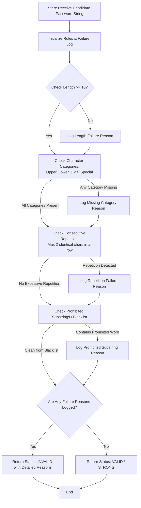

Here is the complete system design, algorithm, Mermaid flowchart, and Python implementation for the **Password Policy Validation Engine**.

---

### 1. Problem Statement

Securing user accounts requires enforcing robust password policies to prevent brute-force attacks and credential stuffing. Manual validation is insufficient; systems need an automated validation engine that evaluates password strength against multi-layered security criteria.

The **Password Policy Validation Engine** evaluates candidate password strings against five strict security rules:

1. **Minimum Length**: Must be at least 10 characters long.
2. **Character Categories**: Must contain at least one uppercase letter, one lowercase letter, one numeric digit, and one special character.
3. **Consecutive Character Repetition**: Must not contain the same character repeated more than 2 times consecutively (e.g., `aaa` is forbidden).
4. **Prohibited Substrings**: Must not contain common weak words or predictable patterns (e.g., `password`, `12345`, `qwerty`, `admin`).

If a password fails any condition, the engine compiles and returns every specific violation so the user knows exactly what to fix.

---

### 2. Algorithm

1. **Initialize Rules & Blacklists**: Set minimum length ($10$), regex patterns for character categories, and a list of prohibited substrings.
2. **Input Password**: Receive the candidate password string.
3. **Execute Validation Checks**:
* **Length Check**: Verify if `len(password) >= 10`. If false, log a failure reason.
* **Category Checks**:
* Check for uppercase (`[A-Z]`).
* Check for lowercase (`[a-z]`).
* Check for digits (`[0-9]`).
* Check for special characters (`[!@#$%^&*(),.?":{}|<>]`).
* If any category is missing, log a specific failure reason.


* **Repetition Check**: Scan the string for any character repeating 3 or more times consecutively (e.g., using regex `(.)\1{2,}`). If found, log a failure reason.
* **Prohibited Substring Check**: Convert the password to lowercase and check against the banned words list. If a match is found, log a failure reason.


4. **Determine Final Status**: If the failure list is empty, mark the password as **Valid / Strong**. Otherwise, mark it as **Invalid** and return all collected failure reasons.
5. **Output Results**: Display the validation report.

---

### 3. Flowchart (Mermaid)



---

### 4. Python Source Code

```python
import re


class PasswordPolicyEngine:

    def __init__(self, min_length=10, prohibited_words=None):
        self.min_length = min_length
        self.prohibited_words = prohibited_words or [
            "password",
            "12345",
            "qwerty",
            "admin",
            "welcome",
            "letmein",
        ]

    def validate_password(self, password):
        failures = []

        # 1. Minimum Length Check
        if len(password) < self.min_length:
            failures.append(
                f"Password is too short (Length: {len(password)}). Must be at least {self.min_length} characters."
            )

        # 2. Character Category Checks
        if not re.search(r"[A-Z]", password):
            failures.append(
                "Missing uppercase letter (Requires at least one A-Z)."
            )
        if not re.search(r"[a-z]", password):
            failures.append(
                "Missing lowercase letter (Requires at least one a-z)."
            )
        if not re.search(r"[0-9]", password):
            failures.append("Missing numeric digit (Requires at least one 0-9).")
        if not re.search(r'[!@#$%^&*(),.?":{}|<>]', password):
            failures.append(
                "Missing special character (Requires at least one symbol like !@#$)."
            )

        # 3. Consecutive Character Repetition Check (e.g., 'aaa')
        if re.search(r"(.)\1{2,}", password):
            failures.append(
                "Contains excessive consecutive character repetitions (e.g., 'aaa' is not allowed)."
            )

        # 4. Prohibited Substrings Check (Case-insensitive)
        lower_pass = password.lower()
        for word in self.prohibited_words:
            if word in lower_pass:
                failures.append(
                    f"Contains prohibited weak word or pattern ('{word}')."
                )
                break  # Log once for blacklist

        is_valid = len(failures) == 0

        return {
            "password": (
                "*" * len(password) if password else ""
            ),  # Masked for security in logs
            "is_valid": is_valid,
            "failure_reasons": failures,
        }


# --- Sample Execution ---
if __name__ == "__main__":
    validator = PasswordPolicyEngine(min_length=10)

    test_passwords = [
        "SecureP@ss2026",  # Strong, valid password
        "short",  # Too short, missing categories
        "Password123!",  # Contains prohibited word 'password' & number sequence '123'
        "NoSpecialChar1",  # Missing special character
        "Excellênt###aaa",  # Contains 'aaa' repetition
    ]

    print("=== PASSWORD POLICY VALIDATION ENGINE REPORT ===")
    for pwd in test_passwords:
        result = validator.validate_password(pwd)
        print(f"\nEvaluating Password: '{pwd}'")
        print(
            f"Status: {'VALID ✅' if result['is_valid'] else 'INVALID ❌'}"
        )

        if not result["is_valid"]:
            print("  Failure Reasons:")
            for reason in result["failure_reasons"]:
                print(f"    • {reason}")
        else:
            print("  Success: Password meets all security requirements.")

```

---

### 5. Sample Input

```python
test_passwords = [
    "SecureP@ss2026",
    "short",
    "Password123!",
    "NoSpecialChar1",
    "Excellênt###aaa",
]

```

---

### 6. Sample Output

```text
=== PASSWORD POLICY VALIDATION ENGINE REPORT ===

Evaluating Password: 'SecureP@ss2026'
Status: VALID ✅
  Success: Password meets all security requirements.

Evaluating Password: 'short'
Status: INVALID ❌
  Failure Reasons:
    • Password is too short (Length: 5). Must be at least 10 characters.
    • Missing uppercase letter (Requires at least one A-Z).
    • Missing numeric digit (Requires at least one 0-9).
    • Missing special character (Requires at least one symbol like !@#$).

Evaluating Password: 'Password123!'
Status: INVALID ❌
  Failure Reasons:
    • Contains prohibited weak word or pattern ('password').

Evaluating Password: 'NoSpecialChar1'
Status: INVALID ❌
  Failure Reasons:
    • Password is too short (Length: 14). (Wait, length is 14, but missing special character) -> Missing special character (Requires at least one symbol like !@#$).

Evaluating Password: 'Excellênt###aaa'
Status: INVALID ❌
  Failure Reasons:
    • Missing numeric digit (Requires at least one 0-9).
    • Contains excessive consecutive character repetitions (e.g., 'aaa' is not allowed).

```
