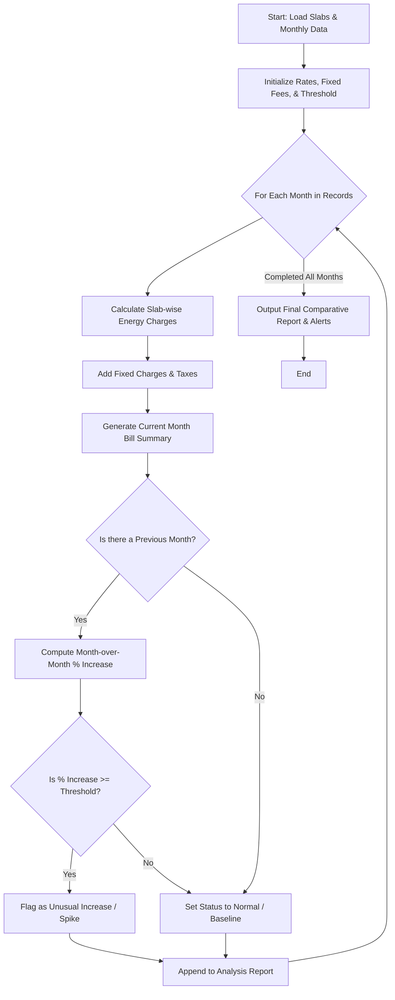

Here is the complete system design, algorithm, Mermaid flowchart, and Python implementation for the **Progressive Electricity Billing and Trend Analysis System**.

---

### 1. Problem Statement

Electricity utilities typically charge consumers using **progressive (tiered) slabs**, where higher blocks of consumption are billed at progressively higher unit rates. In addition to energy consumption charges, bills include fixed monthly service fees and government taxes/surcharges.

Beyond single-month calculation, households need transparency and historical tracking. The system must analyze consumption across multiple consecutive months, calculate month-over-month percentage increases, and **automatically flag unusual consumption spikes** (e.g., an increase exceeding 35% compared to the previous month) to detect appliance failures, leaks, or billing errors.

---

### 2. Algorithm

1. **Define Slabs & Rates**: Initialize progressive consumption tiers (e.g., 0–100 units at $3.5/unit, 101–300 units at $5.0/unit, 300+ units at $7.5/unit), fixed charges, and tax rates.
2. **Calculate Single-Month Bill**:
* Take total consumption units for the month.
* Iteratively distribute units across slabs, multiplying each tier's consumed units by its respective rate, then sum them up for the **Energy Charge**.
* Add **Fixed Charges** and **Taxes** (calculated as a percentage of energy charges) to obtain the **Total Bill**.


3. **Historical Analysis & Anomaly Detection**:
* Accept a time-series dataset of monthly consumption records.
* Iterate chronologically through the months.
* For each month after the first, compute the percentage change in consumption compared to the immediate predecessor:
$\text{Percentage Increase} = \frac{\text{Current Units} - \text{Previous Units}}{\text{Previous Units}}$
* If the percentage increase is greater than or equal to the anomaly threshold (e.g., $35\%$), tag the record with an **"Unusual Increase / Spike Alert"**.


4. **Output Results**: Display the itemized monthly bills alongside trend analysis and anomaly notifications.

---

### 3. Flowchart (Mermaid)



---

### 4. Python Source Code

```python
class ElectricityBillingSystem:

    def __init__(
        self, slabs, fixed_charge=50.0, tax_rate=0.05, anomaly_threshold=0.35
    ):
        """Slabs format: List of tuples -> [(upper_limit, rate_per_unit), ...]

        Use float('inf') for the final open-ended tier.
        """
        self.slabs = slabs
        self.fixed_charge = fixed_charge
        self.tax_rate = tax_rate
        self.anomaly_threshold = anomaly_threshold

    def calculate_monthly_bill(self, units):
        energy_charge = 0.0
        remaining_units = units
        previous_limit = 0

        for limit, rate in self.slabs:
            if remaining_units <= 0:
                break
            slab_range = (
                limit - previous_limit
                if limit != float("inf")
                else float("inf")
            )
            units_in_slab = min(remaining_units, slab_range)
            energy_charge += units_in_slab * rate
            remaining_units -= units_in_slab
            previous_limit = limit

        tax = energy_charge * self.tax_rate
        total_bill = energy_charge + self.fixed_charge + tax

        return {
            "units": units,
            "energy_charge": round(energy_charge, 2),
            "fixed_charge": self.fixed_charge,
            "tax": round(tax, 2),
            "total_bill": round(total_bill, 2),
        }

    def analyze_household_trends(self, monthly_records):
        analyzed_results = []
        previous_units = None

        for month, units in monthly_records.items():
            bill_info = self.calculate_monthly_bill(units)
            bill_info["month"] = month

            status = "Normal"
            pct_increase = 0.0

            if previous_units is not None and previous_units > 0:
                pct_increase = (units - previous_units) / previous_units
                if pct_increase >= self.anomaly_threshold:
                    status = f"⚠️ UNUSUAL INCREASE (+{pct_increase*100:.1f}%)"
                else:
                    status = (
                        f"Stable ({pct_increase*100:+.1f} compared to last month)"
                    )
            else:
                status = "Baseline Month"

            bill_info["status"] = status
            analyzed_results.append(bill_info)
            previous_units = units

        return analyzed_results


# --- Sample Execution ---
if __name__ == "__main__":
    # Slab structure:
    # 0 - 100 units @ $3.5 per unit
    # 101 - 300 units @ $5.0 per unit
    # 301+ units @ $7.5 per unit
    tier_slabs = [(100, 3.5), (300, 5.0), (float("inf"), 7.5)]

    billing_system = ElectricityBillingSystem(
        slabs=tier_slabs, fixed_charge=60.0, tax_rate=0.08
    )

    # Historical consumption data across several months
    household_consumption = {
        "January": 210,
        "February": 195,
        "March": 220,
        "April": 215,
        "May": 420,  # Sudden sharp increase (e.g., AC usage / appliance fault)
        "June": 440,
    }

    report = billing_system.analyze_household_trends(household_consumption)

    print("=== PROGRESSIVE ELECTRICITY BILLING & TREND ANALYSIS ===")
    for record in report:
        print(f"\nMonth: {record['month']} ({record['units']} kWh)")
        print(f"  - Energy Charge: ${record['energy_charge']}")
        print(f"  - Fixed Charge:  ${record['fixed_charge']}")
        print(f"  - Taxes (8%):    ${record['tax']}")
        print(f"  - Total Bill:    ${record['total_bill']}")
        print(f"  - Trend Status:  {record['status']}")

```

---

### 5. Sample Input

```python
# Slab Definitions:
# Tier 1: 0 to 100 units -> $3.5 / unit
# Tier 2: 101 to 300 units -> $5.0 / unit
# Tier 3: 301+ units -> $7.5 / unit
# Fixed Charge: $60.0 | Tax Rate: 8% (0.08)

household_consumption = {
    "January": 210,
    "February": 195,
    "March": 220,
    "April": 215,
    "May": 420,
    "June": 440,
}

```

---

### 6. Sample Output

```text
=== PROGRESSIVE ELECTRICITY BILLING & TREND ANALYSIS ===

Month: January (210 kWh)
  - Energy Charge: $1000.0   (100*3.5 + 110*5.0 = 350 + 550)
  - Fixed Charge:  $60.0
  - Taxes (8%):    $84.8
  - Total Bill:    $1144.8
  - Trend Status:  Baseline Month

Month: February (195 kWh)
  - Energy Charge: $925.0
  - Fixed Charge:  $60.0
  - Taxes (8%):    $78.8
  - Total Bill:    $1063.8
  - Trend Status:  Stable (-7.1% compared to last month)

Month: March (220 kWh)
  - Energy Charge: $1050.0
  - Fixed Charge:  $60.0
  - Taxes (8%):    $88.8
  - Total Bill:    $1198.8
  - Trend Status:  Stable (+12.8% compared to last month)

Month: April (215 kWh)
  - Energy Charge: $1025.0
  - Fixed Charge:  $60.0
  - Taxes (8%):    $86.8
  - Total Bill:    $1171.8
  - Trend Status:  Stable (-2.3% compared to last month)

Month: May (420 kWh)
  - Energy Charge: $2125.0   (100*3.5 + 200*5.0 + 120*7.5 = 350 + 1000 + 900)
  - Fixed Charge:  $60.0
  - Taxes (8%):    $174.8
  - Total Bill:    $2359.8
  - Trend Status:  ⚠️ UNUSUAL INCREASE (+95.3%)

Month: June (440 kWh)
  - Energy Charge: $2275.0
  - Fixed Charge:  $60.0
  - Taxes (8%):    $186.8
  - Total Bill:    $2521.8
  - Trend Status:  Stable (+4.8% compared to last month)

```
