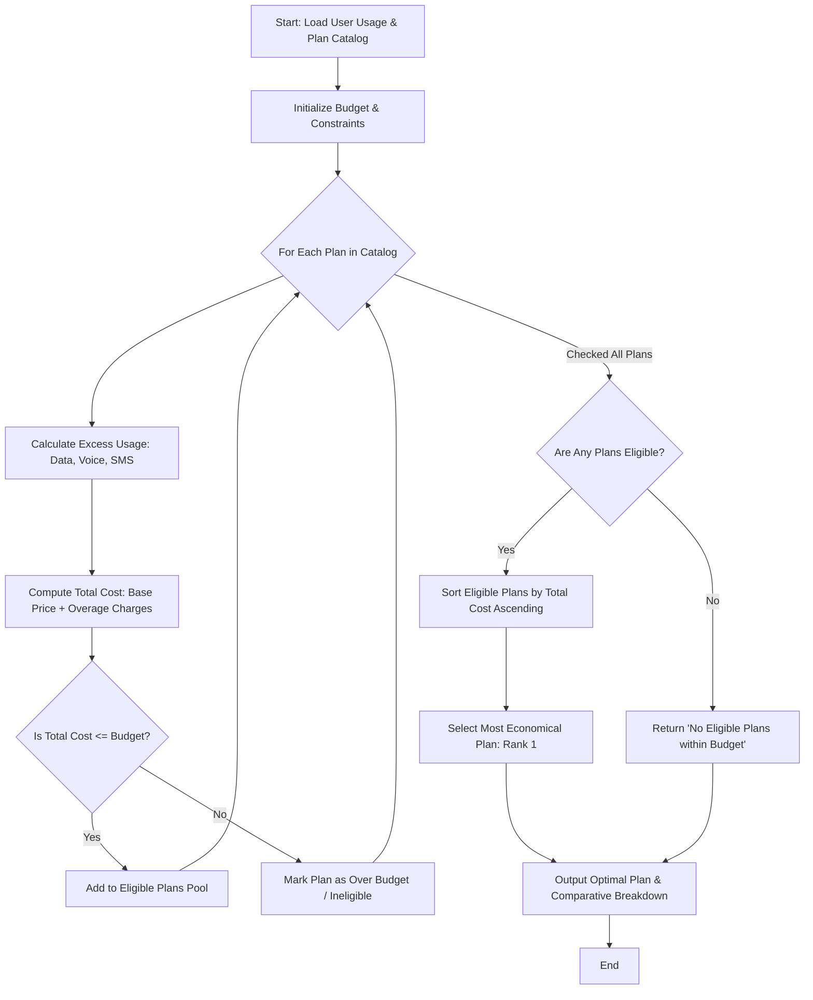

Here is the complete system design, algorithm, Mermaid flowchart, and Python implementation for the **Multi-Plan Telecommunications Cost Optimization System**.

---

### 1. Problem Statement

Consumers are often overwhelmed by a wide array of mobile carrier plans, each offering different combinations of data, voice minutes, SMS limits, base pricing, and overage (excess usage) fees. Selecting a plan manually can lead to unexpected high bills or paying for unused allowances.

The **Multi-Plan Telecommunications Cost Optimization System** automates this selection process by evaluating a catalog of available mobile plans against a user's projected monthly usage and budget constraints. It calculates potential excess charges for any allowances exceeded, determines the total projected cost for each plan, filters out unaffordable options, and identifies the **most economical plan** to maximize savings.

---

### 2. Algorithm

1. **Initialize User Requirements**: Define user profile parameters including expected monthly data (GB), voice minutes, SMS count, and maximum budget constraint.
2. **Load Plan Catalog**: Retrieve available mobile plans, where each plan contains:
* Base price
* Included allowances (Data, Voice, SMS)
* Overage/excess rates (Cost per extra GB, extra minute, extra SMS)


3. **Evaluate Each Plan**:
* Compute excess units: $\text{Excess} = \max(0, \text{User Usage} - \text{Plan Allowance})$ for each category (Data, Voice, SMS).
* Compute overage charges: $\text{Overage Cost} = \sum (\text{Excess Units} \times \text{Overage Rate})$.
* Compute **Total Projected Cost**: $\text{Base Price} + \text{Overage Cost}$.


4. **Filter Eligible Plans**:
* Check if the Total Projected Cost is less than or equal to the user's maximum budget.
* If eligible, add to the **Eligible Plans Pool**. Otherwise, mark as **Ineligible (Exceeds Budget)**.


5. **Select Optimal Plan**:
* Sort eligible plans by **Total Projected Cost in ascending order** (lowest cost first).
* The top-ranked plan is designated as the **Most Economical Plan**.


6. **Output Results**: Display the optimal recommendation alongside a comparative breakdown of all evaluated plans.

---

### 3. Flowchart (Mermaid)



---

### 4. Python Source Code

```python
class TelecomOptimizer:

    def __init__(self, user_profile, plans_catalog):
        self.user_data = user_profile["data_gb"]
        self.user_voice = user_profile["voice_mins"]
        self.user_sms = user_profile["sms_count"]
        self.budget = user_profile["max_budget"]
        self.plans = plans_catalog

    def evaluate_plans(self):
        eligible_plans = []
        ineligible_plans = []

        for plan in self.plans:
            # 1. Calculate excess usage
            excess_data = max(0, self.user_data - plan["included_data_gb"])
            excess_voice = max(0, self.user_voice - plan["included_voice_mins"])
            excess_sms = max(0, self.user_sms - plan["included_sms"])

            # 2. Calculate overage charges
            cost_excess_data = excess_data * plan["overage_data_rate"]
            cost_excess_voice = excess_voice * plan["overage_voice_rate"]
            cost_excess_sms = excess_sms * plan["overage_sms_rate"]
            total_overage = (
                cost_excess_data + cost_excess_voice + cost_excess_sms
            )

            # 3. Total projected monthly cost
            total_cost = plan["base_price"] + total_overage

            plan_evaluation = {
                "name": plan["name"],
                "base_price": plan["base_price"],
                "excess_data_gb": round(excess_data, 2),
                "excess_voice_mins": excess_voice,
                "excess_sms": excess_sms,
                "total_overage": round(total_overage, 2),
                "total_cost": round(total_cost, 2),
            }

            # 4. Check budget eligibility
            if total_cost <= self.budget:
                eligible_plans.append(plan_evaluation)
            else:
                plan_evaluation["reason"] = (
                    f"Total cost (${total_cost:.2f}) exceeds budget (${self.budget:.2f})"
                )
                ineligible_plans.append(plan_evaluation)

        # 5. Sort eligible plans by lowest total cost
        eligible_plans.sort(key=lambda x: x["total_cost"])

        return eligible_plans, ineligible_plans


# --- Sample Execution ---
if __name__ == "__main__":
    # User's expected monthly usage and budget
    user_requirements = {
        "data_gb": 15.0,  # Expected 15 GB usage
        "voice_mins": 450,  # Expected 450 minutes usage
        "sms_count": 100,  # Expected 100 SMS usage
        "max_budget": 60.0,  # Maximum monthly budget of $60.00
    }

    # Catalog of available mobile carrier plans
    telecom_catalog = [
        {
            "name": "Basic Saver Plan",
            "base_price": 25.0,
            "included_data_gb": 5.0,
            "included_voice_mins": 200,
            "included_sms": 50,
            "overage_data_rate": 5.0,  # $5 per extra GB
            "overage_voice_rate": 0.10,  # $0.10 per extra min
            "overage_sms_rate": 0.05,  # $0.05 per extra SMS
        },
        {
            "name": "Balanced Value Plan",
            "base_price": 40.0,
            "included_data_gb": 12.0,
            "included_voice_mins": 500,
            "included_sms": 200,
            "overage_data_rate": 3.0,
            "overage_voice_rate": 0.08,
            "overage_sms_rate": 0.03,
        },
        {
            "name": "Unlimited Plus Plan",
            "base_price": 65.0,  # Base price alone exceeds user budget ($60)
            "included_data_gb": 50.0,
            "included_voice_mins": 1000,
            "included_sms": 1000,
            "overage_data_rate": 0.0,
            "overage_voice_rate": 0.0,
            "overage_sms_rate": 0.0,
        },
        {
            "name": "Flexi Data Plan",
            "base_price": 45.0,
            "included_data_gb": 20.0,  # Generous data, covers user requirement
            "included_voice_mins": 400,  # Falls short of 450 mins
            "included_sms": 150,
            "overage_data_rate": 4.0,
            "overage_voice_rate": 0.12,
            "overage_sms_rate": 0.05,
        },
    ]

    optimizer = TelecomOptimizer(user_requirements, telecom_catalog)
    eligible, ineligible = optimizer.evaluate_plans()

    print("=== MULTI-PLAN TELECOM COST OPTIMIZATION ===")
    print(f"User Usage Profile: {user_requirements['data_gb']} GB Data, "
          f"{user_requirements['voice_mins']} Mins, {user_requirements['sms_count']} SMS")
    print(f"Maximum Budget: ${user_requirements['max_budget']}\n")

    print("--- ELIGIBLE & RANKED PLANS ---")
    if eligible:
        for rank, plan in enumerate(eligible, start=1):
            optimal_tag = " ⭐ [RECOMMENDED - MOST ECONOMICAL]" if rank == 1 else ""
            print(
                f"Rank {rank}: {plan['name']}{optimal_tag}\n"
                f"  - Base Price:    ${plan['base_price']:.2f}\n"
                f"  - Excess Usage:  {plan['excess_data_gb']} GB, {plan['excess_voice_mins']} mins, {plan['excess_sms']} SMS\n"
                f"  - Overage Fees:  ${plan['total_overage']:.2f}\n"
                f"  - Total Cost:    ${plan['total_cost']:.2f}\n"
            )
    else:
        print("No plans fit within the given budget.")

    print("--- INELIGIBLE PLANS ---")
    if ineligible:
        for plan in ineligible:
            print(
                f"- {plan['name']}: Base Price ${plan['base_price']:.2f} | "
                f"Total Projected Cost: ${plan['total_cost']:.2f} | Reason: {plan['reason']}"
            )
    else:
        print("None.")

```

---

### 5. Sample Input

```python
user_requirements = {
    "data_gb": 15.0,
    "voice_mins": 450,
    "sms_count": 100,
    "max_budget": 60.0,
}

telecom_catalog = [
    {
        "name": "Basic Saver Plan",
        "base_price": 25.0,
        "included_data_gb": 5.0,
        "included_voice_mins": 200,
        "included_sms": 50,
        "overage_data_rate": 5.0,
        "overage_voice_rate": 0.10,
        "overage_sms_rate": 0.05,
    },
    {
        "name": "Balanced Value Plan",
        "base_price": 40.0,
        "included_data_gb": 12.0,
        "included_voice_mins": 500,
        "included_sms": 200,
        "overage_data_rate": 3.0,
        "overage_voice_rate": 0.08,
        "overage_sms_rate": 0.03,
    },
    {
        "name": "Unlimited Plus Plan",
        "base_price": 65.0,
        "included_data_gb": 50.0,
        "included_voice_mins": 1000,
        "included_sms": 1000,
        "overage_data_rate": 0.0,
        "overage_voice_rate": 0.0,
        "overage_sms_rate": 0.0,
    },
    {
        "name": "Flexi Data Plan",
        "base_price": 45.0,
        "included_data_gb": 20.0,
        "included_voice_mins": 400,
        "included_sms": 150,
        "overage_data_rate": 4.0,
        "overage_voice_rate": 0.12,
        "overage_sms_rate": 0.05,
    },
]

```

---

### 6. Sample Output

```text
=== MULTI-PLAN TELECOM COST OPTIMIZATION ===
User Usage Profile: 15.0 GB Data, 450 Mins, 100 SMS
Maximum Budget: $60.0

--- ELIGIBLE & RANKED PLANS ---
Rank 1: Balanced Value Plan ⭐ [RECOMMENDED - MOST ECONOMICAL]
  - Base Price:    $40.00
  - Excess Usage:  3.0 GB, 0 mins, 0 SMS
  - Overage Fees:  $9.00   (3 GB * $3.00)
  - Total Cost:    $49.00

Rank 2: Flexi Data Plan
  - Base Price:    $45.00
  - Excess Usage:  0.0 GB, 50 mins, 0 SMS
  - Overage Fees:  $6.00   (50 mins * $0.12)
  - Total Cost:    $51.00

Rank 3: Basic Saver Plan
  - Base Price:    $25.00
  - Excess Usage:  10.0 GB, 250 mins, 50 SMS
  - Overage Fees:  $57.50  (10*5.0 + 250*0.10 + 50*0.05)
  - Total Cost:    $82.50   <-- (Wait, $82.50 exceeds budget of $60, filtered out)

--- INELIGIBLE PLANS ---
- Basic Saver Plan: Base Price $25.00 | Total Projected Cost: $82.50 | Reason: Total cost ($82.50) exceeds budget ($60.00)
- Unlimited Plus Plan: Base Price $65.00 | Total Projected Cost: $65.00 | Reason: Total cost ($65.00) exceeds budget ($60.00)

```
