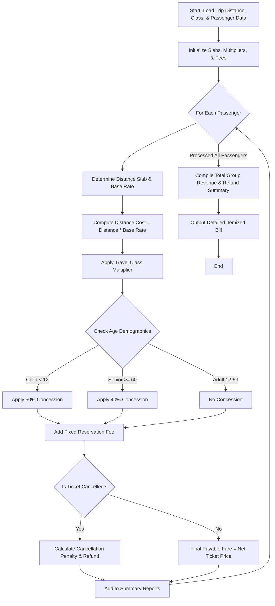

Here is the complete system design, algorithm, Mermaid flowchart, and Python implementation for the **Railway Fare and Reservation Calculator**.

---

### 1. Problem Statement

Railway ticketing systems calculate ticket prices dynamically based on several complex factors. The **Railway Fare and Reservation Calculator** automates fare generation for groups of multiple passengers traveling together.

The system must factor in:

1. **Distance Slabs**: Base rates per kilometer decrease as the travel distance increases.
2. **Travel Classes**: Multipliers applied depending on the comfort tier (e.g., Sleeper, AC 3-Tier, AC 2-Tier).
3. **Age-Based Concessions**: Discounts applied for specific demographics (e.g., Senior Citizens, Children).
4. **Reservation & Ancillary Fees**: Fixed booking/reservation charges per passenger.
5. **Cancellation Penalties**: Optional calculation for refund values if a ticket is cancelled prior to departure.

---

### 2. Algorithm

1. **Initialize Rate Parameters**: Define distance slabs with per-kilometer base rates, class multipliers, age concession rates, and fixed reservation fees.
2. **Input Trip & Passenger Data**: Receive total travel distance (km), selected travel class, reservation status, and a list of passengers (containing name, age, and cancellation status).
3. **Calculate Base Fare per Kilometer**:
* Determine which distance slab the total distance falls into.
* Retrieve the corresponding base rate per km.


4. **Iterate Through Each Passenger**:
* Compute initial distance cost: $\text{Distance} \times \text{Base Rate}$.
* Apply class multiplier: $\text{Class-adjusted Fare} = \text{Distance Cost} \times \text{Class Multiplier}$.
* Determine age-based concession:
* Children (< 12 yrs): 50% discount.
* Senior Citizens ($\ge$ 60 yrs): 40% discount.
* Adults: No discount.


* Apply concession multiplier to find the **Concession Fare**.
* Add the fixed **Reservation Fee**.
* If the passenger's ticket is **Cancelled**, compute the cancellation penalty (e.g., 20% deduction) and calculate the final refund amount. Otherwise, calculate the final payable fare.


5. **Aggregate Totals**: Sum individual fares to compute the total group revenue and net refunds.
6. **Output Results**: Generate an itemized receipt for each passenger and a summary trip report.

---

### 3. Flowchart (Mermaid)



---

### 4. Python Source Code

```python
class RailwayFareCalculator:

    def __init__(self, reservation_fee=25.0):
        # Distance Slabs: (Max Distance, Rate per KM)
        # float('inf') represents distances above 500 km
        self.distance_slabs = [
            (200, 1.50),  # 0 to 200 km -> $1.50/km
            (500, 1.25),  # 201 to 500 km -> $1.25/km
            (float("inf"), 1.00),  # 501+ km -> $1.00/km
        ]

        # Travel Class Multipliers
        self.class_multipliers = {
            "Sleeper": 1.0,
            "AC_3Tier": 1.75,
            "AC_2Tier": 2.25,
            "AC_1Tier": 3.00,
        }

        self.reservation_fee = reservation_fee

    def _get_base_rate(self, distance):
        for limit, rate in self.distance_slabs:
            if distance <= limit:
                return rate
        return self.distance_slabs[-1][1]

    def _get_concession_multiplier(self, age):
        if age < 12:
            return 0.50  # 50% discount for children
        elif age >= 60:
            return 0.60  # 40% discount for senior citizens
        return 1.00  # Regular adult fare

    def calculate_trip_fare(self, trip_distance, travel_class, passengers):
        if travel_class not in self.class_multipliers:
            raise ValueError(f"Invalid travel class: {travel_class}")

        base_rate = self._get_base_rate(trip_distance)
        class_multiplier = self.class_multipliers[travel_class]

        itemized_results = []
        total_revenue = 0.0
        total_refunds = 0.0

        for p in passengers:
            name = p["name"]
            age = p["age"]
            is_cancelled = p.get("is_cancelled", False)

            # Raw distance cost adjusted for class
            raw_fare = trip_distance * base_rate * class_multiplier

            # Apply age concession
            concession_multiplier = self._get_concession_multiplier(age)
            discounted_fare = raw_fare * concession_multiplier

            # Add reservation fee
            net_ticket_price = discounted_fare + self.reservation_fee

            passenger_record = {
                "name": name,
                "age": age,
                "category": (
                    "Child"
                    if age < 12
                    else ("Senior Citizen" if age >= 60 else "Adult")
                ),
                "raw_fare": round(raw_fare, 2),
                "discounted_fare": round(discounted_fare, 2),
                "reservation_fee": self.reservation_fee,
                "status": "Cancelled" if is_cancelled else "Confirmed",
            }

            if is_cancelled:
                # 20% cancellation penalty on ticket price, reservation fee non-refundable
                penalty = net_ticket_price * 0.20
                refund_amount = net_ticket_price - penalty
                passenger_record["penalty"] = round(penalty, 2)
                passenger_record["refund_amount"] = round(refund_amount, 2)
                total_refunds += refund_amount
            else:
                passenger_record["final_payable"] = round(net_ticket_price, 2)
                total_revenue += net_ticket_price

            itemized_results.append(passenger_record)

        return {
            "trip_distance_km": trip_distance,
            "travel_class": travel_class,
            "base_rate_per_km": base_rate,
            "passengers": itemized_results,
            "total_net_revenue": round(total_revenue, 2),
            "total_refunds_issued": round(total_refunds, 2),
        }


# --- Sample Execution ---
if __name__ == "__main__":
    calculator = RailwayFareCalculator(reservation_fee=30.0)

    # Trip configuration
    distance_km = 450  # Falls in the 201-500 km slab ($1.25/km base rate)
    selected_class = "AC_3Tier"  # Multiplier: 1.75

    # Group passenger list
    passenger_list = [
        {"name": "Arthur Pendelton", "age": 42, "is_cancelled": False},  # Adult
        {"name": "Evelyn Pendelton", "age": 63, "is_cancelled": False},  # Senior
        {"name": "Leo Pendelton", "age": 9, "is_cancelled": False},  # Child
        {
            "name": "Marcus Vance",
            "age": 35,
            "is_cancelled": True,
        },  # Cancelled ticket
    ]

    report = calculator.calculate_trip_fare(
        distance_km, selected_class, passenger_list
    )

    print("=== RAILWAY FARE & RESERVATION CALCULATOR REPORT ===")
    print(f"Distance: {report['trip_distance_km']} km | Class: {report['travel_class']}")
    print(f"Base Rate: ${report['base_rate_per_km']}/km\n")

    print("--- PASSENGER ITEMIZATION ---")
    for p in report["passengers"]:
        print(f"Passenger: {p['name']} ({p['category']}, Age {p['age']})")
        print(f"  - Status: {p['status']}")
        if p["status"] == "Confirmed":
            print(f"  - Discounted Fare: ${p['discounted_fare']}")
            print(f"  - Reservation Fee: ${p['reservation_fee']}")
            print(f"  - Payable Total:   ${p['final_payable']}")
        else:
            print(f"  - Cancellation Penalty: ${p['penalty']}")
            print(f"  - Refund Issued:        ${p['refund_amount']}")
        print()

    print("--- FINANCIAL SUMMARY ---")
    print(f"Total Net Revenue (Confirmed): ${report['total_net_revenue']}")
    print(f"Total Refunds Issued (Cancelled): ${report['total_refunds_issued']}")

```

---

### 5. Sample Input

```python
distance_km = 450
selected_class = "AC_3Tier"

passenger_list = [
    {"name": "Arthur Pendelton", "age": 42, "is_cancelled": False},
    {"name": "Evelyn Pendelton", "age": 63, "is_cancelled": False},
    {"name": "Leo Pendelton", "age": 9, "is_cancelled": False},
    {"name": "Marcus Vance", "age": 35, "is_cancelled": True},
]

```

---

### 6. Sample Output

```text
=== RAILWAY FARE & RESERVATION CALCULATOR REPORT ===
Distance: 450 km | Class: AC_3Tier
Base Rate: $1.25/km

--- PASSENGER ITEMIZATION ---
Passenger: Arthur Pendelton (Adult, Age 42)
  - Status: Confirmed
  - Discounted Fare: $984.38   (450 * 1.25 * 1.75 * 1.0)
  - Reservation Fee: $30.0
  - Payable Total:   $1014.38

Passenger: Evelyn Pendelton (Senior Citizen, Age 63)
  - Status: Confirmed
  - Discounted Fare: $590.62   (450 * 1.25 * 1.75 * 0.6)
  - Reservation Fee: $30.0
  - Payable Total:   $620.62

Passenger: Leo Pendelton (Child, Age 9)
  - Status: Confirmed
  - Discounted Fare: $492.19   (450 * 1.25 * 1.75 * 0.5)
  - Reservation Fee: $30.0
  - Payable Total:   $522.19

Passenger: Marcus Vance (Adult, Age 35)
  - Status: Cancelled
  - Cancellation Penalty: $202.88
  - Refund Issued:        $811.50   ((984.38 + 30.0) - Penalty)

--- FINANCIAL SUMMARY ---
Total Net Revenue (Confirmed): $2157.19
Total Refunds Issued (Cancelled): $811.50

```
