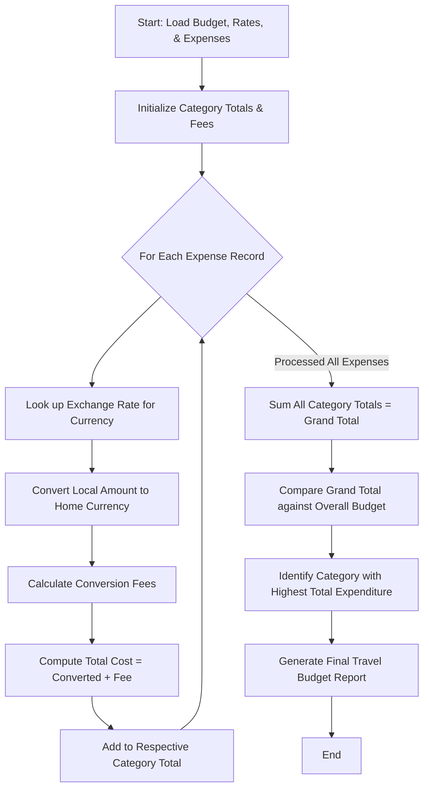

Here is the complete system design, algorithm, Mermaid flowchart, and Python implementation for the **Multi-Currency Travel Budget Analysis** system.

---

### 1. Problem Statement

International travelers frequently incur expenses in multiple foreign currencies. Tracking these expenditures manually introduces challenges due to fluctuating exchange rates, varying transaction/conversion fees charged by banks, and monitoring overall spending against a fixed home currency budget.

The **Multi-Currency Travel Budget Analysis System** automates this process by:

1. Converting all foreign currency expenses into a unified home currency using supplied exchange rates.
2. Factoring in transaction conversion fees (percentage-based or fixed) for each purchase.
3. Aggregating spending by category and comparing total outlays against the overall travel budget.
4. Identifying the largest expense category to provide actionable financial insights.

---

### 2. Algorithm

1. **Initialize Parameters**: Set home currency, total overall budget, exchange rate mappings, and transaction fee rules.
2. **Input Expenses**: Receive a list of expense entries containing category, description, local amount, and local currency code.
3. **Process Each Expense**:
* Retrieve the exchange rate for the local currency relative to the home currency.
* Convert the local amount to the home currency: $\text{Converted Amount} = \text{Local Amount} \times \text{Exchange Rate}$.
* Calculate conversion fees (e.g., a 2% processing fee plus a $1.50 flat network fee).
* Compute total item cost: $\text{Total Cost} = \text{Converted Amount} + \text{Fee}$.


4. **Aggregate Data**:
* Group total expenses by category (e.g., Accommodation, Food, Transport, Sightseeing).
* Sum all category totals to find the **Grand Total Expenditure** including fees.


5. **Compare Against Budget**:
* Calculate budget variance: $\text{Variance} = \text{Budget} - \text{Grand Total}$.
* Determine if the traveler is within budget or facing a deficit.


6. **Identify Top Expense Category**: Sort categories by total expenditure in descending order to pinpoint the largest spending area.
7. **Output Results**: Generate an itemized transaction log, category breakdown, budget comparison status, and anomaly/peak insights.

---

### 3. Flowchart (Mermaid)



---

### 4. Python Source Code

```python
class TravelBudgetAnalyzer:

    def __init__(self, home_currency, total_budget, exchange_rates, fee_rules):
        self.home_currency = home_currency
        self.total_budget = total_budget
        self.exchange_rates = exchange_rates  # Dictionary: {Currency_Code: Rate}
        self.fee_percentage = fee_rules.get("percentage", 0.02)  # e.g., 2%
        self.fee_flat = fee_rules.get("flat_fee", 1.00)  # e.g., $1.00 flat fee

    def analyze_expenses(self, expenses):
        itemized_records = []
        category_totals = {}
        grand_total = 0.0
        total_fees_paid = 0.0

        for exp in expenses:
            category = exp["category"]
            local_amount = exp["local_amount"]
            currency = exp["currency"]

            if currency == self.home_currency:
                converted_amount = local_amount
                fee = 0.0
            else:
                if currency not in self.exchange_rates:
                    raise ValueError(
                        f"Exchange rate for currency '{currency}' not found."
                    )
                rate = self.exchange_rates[currency]
                converted_amount = local_amount * rate
                # Calculate transaction fee
                fee = (converted_amount * self.fee_percentage) + self.fee_flat

            total_item_cost = converted_amount + fee
            grand_total += total_item_cost
            total_fees_paid += fee

            # Aggregate category totals
            category_totals[category] = (
                category_totals.get(category, 0.0) + total_item_cost
            )

            itemized_records.append(
                {
                    "description": exp["description"],
                    "category": category,
                    "local_amount": local_amount,
                    "currency": currency,
                    "converted_amount": round(converted_amount, 2),
                    "fee": round(fee, 2),
                    "total_cost": round(total_item_cost, 2),
                }
            )

        # Budget comparison
        budget_variance = self.total_budget - grand_total
        budget_status = (
            f"Under Budget by ${abs(budget_variance):.2f}"
            if budget_variance >= 0
            else f"Over Budget by ${abs(budget_variance):.2f} ⚠️"
        )

        # Identify largest expense category
        largest_category = max(
            category_totals.items(), key=lambda x: x[1]
        ) if category_totals else ("None", 0.0)

        # Format category totals
        formatted_categories = {
            cat: round(amt, 2) for cat, amt in category_totals.items()
        }

        return {
            "itemized_records": itemized_records,
            "category_totals": formatted_categories,
            "grand_total": round(grand_total, 2),
            "total_fees_paid": round(total_fees_paid, 2),
            "budget_status": budget_status,
            "largest_expense_category": {
                "category": largest_category[0],
                "amount": round(largest_category[1], 2),
            },
        }


# --- Sample Execution ---
if __name__ == "__main__":
    # Configuration
    HOME_CURRENCY = "USD"
    TOTAL_BUDGET = 2500.00

    # Exchange rates relative to USD (1 unit of foreign currency = X USD)
    rates = {
        "EUR": 1.08,  # Euro
        "JPY": 0.0065,  # Japanese Yen
        "GBP": 1.28,  # British Pound
    }

    # Conversion fee structure: 1.5% fee + $1.50 flat network transaction fee
    fees = {"percentage": 0.015, "flat_fee": 1.50}

    # Travel expenses list across different countries/currencies
    trip_expenses = [
        {
            "description": "Hotel Booking Paris",
            "category": "Accommodation",
            "local_amount": 750.0,
            "currency": "EUR",
        },
        {
            "description": "Shinkansen Bullet Train Ticket",
            "category": "Transport",
            "local_amount": 22000.0,
            "currency": "JPY",
        },
        {
            "description": "Dinners & Cafes in London",
            "category": "Food & Dining",
            "local_amount": 350.0,
            "currency": "GBP",
        },
        {
            "description": "Museum Passes",
            "category": "Sightseeing",
            "local_amount": 120.0,
            "currency": "EUR",
        },
        {
            "description": "Airport Taxi (Home)",
            "category": "Transport",
            "local_amount": 45.0,
            "currency": "USD",
        },  # Home currency, no conversion fee
        {
            "description": "Souvenirs & Gifts",
            "category": "Shopping",
            "local_amount": 45000.0,
            "currency": "JPY",
        },
    ]

    analyzer = TravelBudgetAnalyzer(
        HOME_CURRENCY, TOTAL_BUDGET, rates, fees
    )
    report = analyzer.analyze_expenses(trip_expenses)

    print("=== MULTI-CURRENCY TRAVEL BUDGET ANALYSIS ===")
    print(f"Overall Budget: ${TOTAL_BUDGET:.2f} {HOME_CURRENCY}\n")

    print("--- ITEMIZED EXPENSES (CONVERTED TO USD) ---")
    for rec in report["itemized_records"]:
        print(
            f"• {rec['description']} [{rec['category']}] | "
            f"Original: {rec['local_amount']} {rec['currency']} | "
            f"Converted: ${rec['converted_amount']} + Fee: ${rec['fee']} = "
            f"Total: ${rec['total_cost']}"
        )

    print("\n--- CATEGORY BREAKDOWN ---")
    for cat, amount in report["category_totals"].items():
        print(f"  - {cat}: ${amount}")

    print(
        f"\n💡 Largest Expense Category: {report['largest_expense_category']['category']} "
        f"(${report['largest_expense_category']['amount']})"
    )
    print(f"Total Fees Incurred: ${report['total_fees_paid']}")
    print(f"Grand Total Expenditure: ${report['grand_total']}")
    print(f"Budget Health: {report['budget_status']}")

```

---

### 5. Sample Input

```python
HOME_CURRENCY = "USD"
TOTAL_BUDGET = 2500.00

rates = {"EUR": 1.08, "JPY": 0.0065, "GBP": 1.28}
fees = {"percentage": 0.015, "flat_fee": 1.50}

trip_expenses = [
    {
        "description": "Hotel Booking Paris",
        "category": "Accommodation",
        "local_amount": 750.0,
        "currency": "EUR",
    },
    {
        "description": "Shinkansen Bullet Train Ticket",
        "category": "Transport",
        "local_amount": 22000.0,
        "currency": "JPY",
    },
    {
        "description": "Dinners & Cafes in London",
        "category": "Food & Dining",
        "local_amount": 350.0,
        "currency": "GBP",
    },
    {
        "description": "Museum Passes",
        "category": "Sightseeing",
        "local_amount": 120.0,
        "currency": "EUR",
    },
    {
        "description": "Airport Taxi (Home)",
        "category": "Transport",
        "local_amount": 45.0,
        "currency": "USD",
    },
    {
        "description": "Souvenirs & Gifts",
        "category": "Shopping",
        "local_amount": 45000.0,
        "currency": "JPY",
    },
]

```

---

### 6. Sample Output

```text
=== MULTI-CURRENCY TRAVEL BUDGET ANALYSIS ===
Overall Budget: $2500.00 USD

--- ITEMIZED EXPENSES (CONVERTED TO USD) ---
• Hotel Booking Paris [Accommodation] | Original: 750.0 EUR | Converted: $810.0 + Fee: $13.65 = Total: $823.65
• Shinkansen Bullet Train Ticket [Transport] | Original: 22000.0 JPY | Converted: $143.0 + Fee: $3.65 = Total: $146.65
• Dinners & Cafes in London [Food & Dining] | Original: 350.0 GBP | Converted: $448.0 + Fee: $8.22 = Total: $456.22
• Museum Passes [Sightseeing] | Original: 120.0 EUR | Converted: $129.6 + Fee: $3.44 = Total: $133.04
• Airport Taxi (Home) [Transport] | Original: 45.0 USD | Converted: $45.0 + Fee: $0.0 = Total: $45.00
• Souvenirs & Gifts [Shopping] | Original: 45000.0 JPY | Converted: $292.5 + Fee: $5.89 = Total: $298.39

--- CATEGORY BREAKDOWN ---
  - Accommodation: $823.65
  - Transport: $191.65
  - Food & Dining: $456.22
  - Sightseeing: $133.04
  - Shopping: $298.39

💡 Largest Expense Category: Accommodation ($823.65)
Total Fees Incurred: $34.85
Grand Total Expenditure: $1902.95
Budget Health: Under Budget by $597.05

```

---
