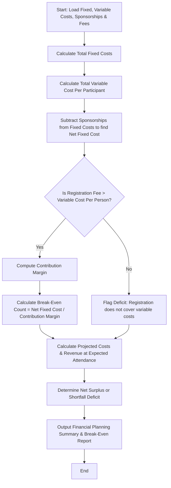

Here is the complete system design, algorithm, Mermaid flowchart, and Python implementation for the **Campus Event Financial Planning System**.

---

### 1. Problem Statement

Organizing university symposiums, tech fests, or cultural events requires precise financial forecasting to avoid funding deficits. Organizers must account for multiple expense types categorized into **fixed costs** (independent of attendance, such as venue rental, sound equipment, and transportation) and **variable costs** (scaling per participant, such as catering kits and custom certificates).

The system must factor in corporate or departmental sponsorships, participant registration fees, and calculate the **break-even participant count** to determine the minimum turnout required to cover all expenses without incurring a loss.

---

### 2. Algorithm

1. **Initialize Budget Categories**:
* Fixed Costs: Venue fee, equipment rental, transport.
* Variable Costs (per person): Catering cost per participant, certificate/kit cost per participant.
* Funding & Revenue: Total sponsorships secured, participant registration fee per head, and expected attendee count.


2. **Compute Cost Totals**:
* $\text{Total Fixed Costs} = \text{Venue} + \text{Equipment} + \text{Transport}$
* $\text{Variable Cost Per Person} = \text{Catering} + \text{Certificate}$


3. **Incorporate Sponsorships & Determine Net Fixed Cost**:
* $\text{Net Fixed Cost} = \text{Total Fixed Costs} - \text{Total Sponsorships}$


4. **Calculate Contribution Margin**:
* $\text{Contribution Margin} = \text{Registration Fee per Person} - \text{Variable Cost Per Person}$


5. **Calculate Break-Even Point**:
* If $\text{Contribution Margin} \le 0$, the event cannot break even because revenue per person does not cover variable costs.
* Otherwise, $\text{Break-Even Registration Count} = \lceil \frac{\text{Net Fixed Cost}}{\text{Contribution Margin}} \rceil$ (rounded up to the nearest whole person).


6. **Project Expected Financial Status**:
* $\text{Total Projected Cost} = \text{Total Fixed Costs} + (\text{Variable Cost Per Person} \times \text{Expected Participants})$
* $\text{Total Projected Revenue} = (\text{Registration Fee} \times \text{Expected Participants}) + \text{Total Sponsorships}$
* $\text{Net Balance} = \text{Total Projected Revenue} - \text{Total Projected Cost}$ (Surplus if positive, Shortfall/Deficit if negative).


7. **Output Results**: Display itemized budgets, break-even targets, and projected financial health.

---

### 3. Flowchart (Mermaid)



---

### 4. Python Source Code

```python
import math


class CampusEventPlanner:

    def __init__(
        self,
        fixed_costs,
        variable_costs_per_person,
        sponsorships,
        registration_fee,
        expected_participants,
    ):
        self.venue = fixed_costs.get("venue", 0.0)
        self.equipment = fixed_costs.get("equipment", 0.0)
        self.transport = fixed_costs.get("transport", 0.0)

        self.catering_unit = variable_costs_per_person.get("catering", 0.0)
        self.certificate_unit = variable_costs_per_person.get(
            "certificate", 0.0
        )

        self.sponsorships = sponsorships
        self.registration_fee = registration_fee
        self.expected_participants = expected_participants

    def generate_financial_report(self):
        total_fixed = self.venue + self.equipment + self.transport
        variable_unit_total = self.catering_unit + self.certificate_unit

        net_fixed_cost = total_fixed - self.sponsorships
        contribution_margin = self.registration_fee - variable_unit_total

        # Break-even calculation
        if contribution_margin <= 0:
            break_even_count = float("inf")
        else:
            break_even_count = math.ceil(
                max(0, net_fixed_cost) / contribution_margin
            )

        # Projections based on expected attendees
        total_variable_projected = (
            variable_unit_total * self.expected_participants
        )
        total_projected_cost = total_fixed + total_variable_projected

        participant_revenue = self.registration_fee * self.expected_participants
        total_projected_revenue = participant_revenue + self.sponsorships

        net_balance = total_projected_revenue - total_projected_cost

        return {
            "total_fixed_costs": round(total_fixed, 2),
            "variable_cost_per_person": round(variable_unit_total, 2),
            "net_fixed_cost": round(net_fixed_cost, 2),
            "contribution_margin": round(contribution_margin, 2),
            "break_even_count": break_even_count,
            "total_projected_cost": round(total_projected_cost, 2),
            "participant_revenue": round(participant_revenue, 2),
            "total_projected_revenue": round(total_projected_revenue, 2),
            "net_balance": round(net_balance, 2),
        }


# --- Sample Execution ---
if __name__ == "__main__":
    # Fixed Costs (Independent of participant count)
    fixed_budget = {
        "venue": 1500.00,  # Auditorium booking
        "equipment": 600.00,  # Sound system, projectors, lights
        "transport": 350.00,  # Guest speaker shuttle/transport
    }

    # Variable Costs (Per participant)
    variable_budget = {
        "catering": 12.00,  # Lunch & snacks per person
        "certificate": 3.00,  # Printing badge, kit folder, certificate
    }

    total_sponsorships_received = 1200.00
    registration_fee_per_student = 25.00
    expected_attendees = 180

    planner = CampusEventPlanner(
        fixed_costs=fixed_budget,
        variable_costs_per_person=variable_budget,
        sponsorships=total_sponsorships_received,
        registration_fee=registration_fee_per_student,
        expected_participants=expected_attendees,
    )

    report = planner.generate_financial_report()

    print("=== CAMPUS EVENT FINANCIAL PLANNING REPORT ===")
    print(f"Total Fixed Costs:        ${report['total_fixed_costs']}")
    print(f"Total Sponsorships:       ${total_sponsorships_received}")
    print(f"Net Fixed Cost to Cover:  ${report['net_fixed_cost']}\n")

    print(f"Variable Cost per Person: ${report['variable_cost_per_person']}")
    print(f"Registration Fee / Head:  ${registration_fee_per_student}")
    print(f"Contribution Margin:      ${report['contribution_margin']} per person\n")

    if report["break_even_count"] == float("inf"):
        print(
            "⚠️ BREAK-EVEN STATUS: Impossible (Registration fee is lower than variable cost per head!)"
        )
    else:
        print(
            f"🎯 Minimum Break-Even Registration Count: {report['break_even_count']} participants"
        )

    print(f"\n--- PROJECTIONS FOR {expected_attendees} ATTENDEES ---")
    print(f"Projected Total Cost:     ${report['total_projected_cost']}")
    print(f"Projected Total Revenue:  ${report['total_projected_revenue']}")

    if report["net_balance"] >= 0:
        print(
            f"💰 Projected Financial Status: SURPLUS of ${report['net_balance']}"
        )
    else:
        print(
            f"⚠️ Projected Financial Status: SHORTFALL / DEFICIT of ${abs(report['net_balance'])}"
        )

```

---

### 5. Sample Input

```python
fixed_budget = {"venue": 1500.00, "equipment": 600.00, "transport": 350.00}

variable_budget = {"catering": 12.00, "certificate": 3.00}

total_sponsorships_received = 1200.00
registration_fee_per_student = 25.00
expected_attendees = 180

```

---

### 6. Sample Output

```text
=== CAMPUS EVENT FINANCIAL PLANNING REPORT ===
Total Fixed Costs:        $2450.0
Total Sponsorships:       $1200.0
Net Fixed Cost to Cover:  $1250.0

Variable Cost per Person: $15.0
Registration Fee / Head:  $25.0
Contribution Margin:      $10.0 per person

🎯 Minimum Break-Even Registration Count: 125 participants

--- PROJECTIONS FOR 180 ATTENDEES ---
Projected Total Cost:     $5150.0
Projected Total Revenue:  $5700.0
💰 Projected Financial Status: SURPLUS of $550.0

```

---
