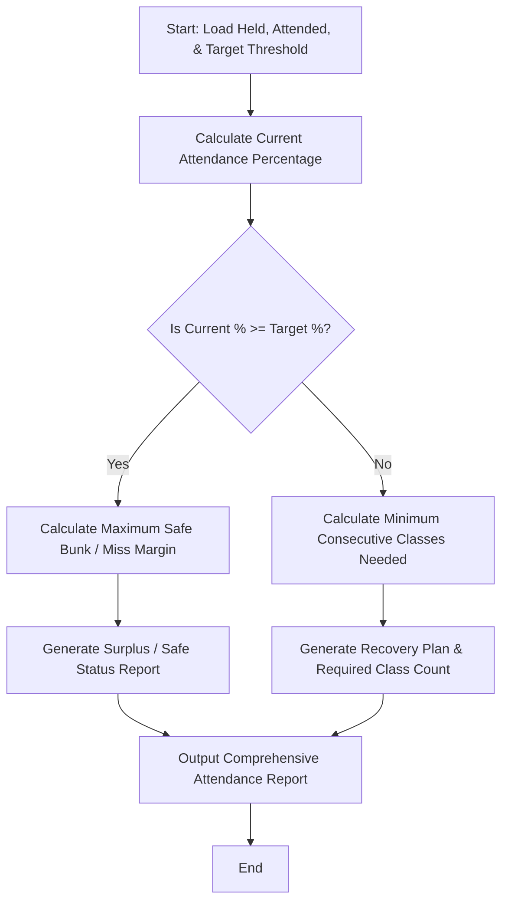

Here is the complete system design, algorithm, Mermaid flowchart, and Python implementation for the **Attendance Recovery Computation** system.

---

### 1. Problem Statement

Many educational institutions enforce a strict minimum attendance threshold (e.g., 75.0%) for exam eligibility. Students often find themselves below this threshold and need a precise mathematical recovery plan.

The **Attendance Recovery Computation System** evaluates a student's current standing (total classes held vs. attended), checks eligibility against a target percentage, and dynamically calculates:

1. The **exact number of consecutive future classes** the student must attend without missing any to recover and hit the target threshold.
2. Conversely, if the student is already above the threshold, how many classes they can **safely miss (bunk margin)** while remaining compliant.

---

### 2. Algorithm

1. **Input Parameters**: Receive total classes held so far, classes attended so far, and the mandatory target percentage (e.g., 75.0%).
2. **Validate Inputs**: Ensure classes held > 0, attended $\le$ held, and target percentage is between 0 and 100.
3. **Calculate Current Status**:
* $\text{Current Percentage} = \left(\frac{\text{Classes Attended}}{\text{Classes Held}}\right) \times 100$


4. **Evaluate Against Target**:
* **Case A: Current Percentage $\ge$ Target** (Eligible / Safe)
* Calculate maximum future classes that can be missed consecutively while keeping attendance $\ge$ Target:
$\text{Max Misses} = \left\lfloor \frac{\text{Attended} - (\frac{\text{Target}}{100} \times \text{Held})}{\frac{\text{Target}}{100}} \right\rfloor$


* **Case B: Current Percentage $<$ Target** (Shortage / Recovery Needed)
* Compute minimum consecutive classes $x$ to attend:
$\text{Required Classes } x = \left\lceil \frac{\left(\frac{\text{Target}}{100} \times \text{Held}\right) - \text{Attended}}{1 - \left(\frac{\text{Target}}{100}\right)} \right\rceil$


5. **Output Results**: Display current attendance metrics and the precise recovery or safe-margin action plan.

---

### 3. Flowchart (Mermaid)



---

### 4. Python Source Code

```python
import math


class AttendanceRecoverySystem:

    def __init__(self, target_percentage=75.0):
        self.target_percentage = target_percentage

    def analyze_attendance(self, total_held, total_attended):
        if total_held <= 0:
            raise ValueError("Total classes held must be greater than zero.")
        if total_attended > total_held:
            raise ValueError("Attended classes cannot exceed total classes held.")

        current_percentage = (total_attended / total_held) * 100.0
        target_ratio = self.target_percentage / 100.0

        result = {
            "total_held": total_held,
            "total_attended": total_attended,
            "current_percentage": round(current_percentage, 2),
            "target_percentage": self.target_percentage,
        }

        if current_percentage >= self.target_percentage:
            # Already eligible, calculate how many can be safely missed
            # Formula: (Attended - Target_Ratio * Held) / Target_Ratio
            safe_misses = math.floor(
                (total_attended - (target_ratio * total_held)) / target_ratio
            )
            result["status"] = "ELIGIBLE (Above Target)"
            result["safe_misses_allowed"] = max(0, safe_misses)
            result["message"] = (
                f"You are safe! You can miss up to {max(0, safe_misses)} upcoming classes "
                f"and still maintain at least {self.target_percentage}% attendance."
            )
        else:
            # Shortage, calculate minimum consecutive classes needed
            # Formula: ceil( (Target_Ratio * Held - Attended) / (1 - Target_Ratio) )
            numerator = (target_ratio * total_held) - total_attended
            denominator = 1.0 - target_ratio
            classes_needed = math.ceil(numerator / denominator)

            result["status"] = "SHORTAGE (Recovery Required)"
            result["classes_needed_consecutive"] = classes_needed
            result["message"] = (
                f"Attendance shortfall detected. You must attend the next "
                f"{classes_needed} consecutive classes without missing any "
                f"to reach the {self.target_percentage}% threshold."
            )

        return result


# --- Sample Execution ---
if __name__ == "__main__":
    system = AttendanceRecoverySystem(target_percentage=75.0)

    # Test Scenarios
    scenarios = [
        {"name": "Student A (Shortage)", "held": 40, "attended": 26},  # 65.0%
        {
            "name": "Student B (Borderline/Safe)",
            "held": 50,
            "attended": 39,
        },  # 78.0%
        {"name": "Student C (Critical Shortage)", "held": 60, "attended": 35},  # 58.33%
    ]

    print("=== ATTENDANCE RECOVERY & STATUS ANALYSIS ===\n")
    for student in scenarios:
        report = system.analyze_attendance(student["held"], student["attended"])
        print(f"--- {student['name']} ---")
        print(f"Classes Held: {report['total_held']} | Attended: {report['total_attended']}")
        print(f"Current Attendance: {report['current_percentage']}%")
        print(f"Status: {report['status']}")
        print(f"Action Guide: {report['message']}\n")

```

---

### 5. Sample Input

```python
# Target Attendance Threshold: 75.0%
# Scenario 1: Student A
total_held_1 = 40
total_attended_1 = 26

# Scenario 2: Student B
total_held_2 = 50
total_attended_2 = 39

```

---

### 6. Sample Output

```text
=== ATTENDANCE RECOVERY & STATUS ANALYSIS ===

--- Student A (Shortage) ---
Classes Held: 40 | Attended: 26
Current Attendance: 65.0%
Status: SHORTAGE (Recovery Required)
Action Guide: Attendance shortfall detected. You must attend the next 10 consecutive classes without missing any to reach the 75.0% threshold.

--- Student B (Borderline/Safe) ---
Classes Held: 50 | Attended: 39
Current Attendance: 78.0%
Status: ELIGIBLE (Above Target)
Action Guide: You are safe! You can miss up to 2 upcoming classes and still maintain at least 75.0% attendance.

--- Student C (Critical Shortage) ---
Classes Held: 60 | Attended: 35
Current Attendance: 58.33%
Status: SHORTAGE (Recovery Required)
Action Guide: Attendance shortfall detected. You must attend the next 35 consecutive classes without missing any to reach the 75.0% threshold.

```

---
