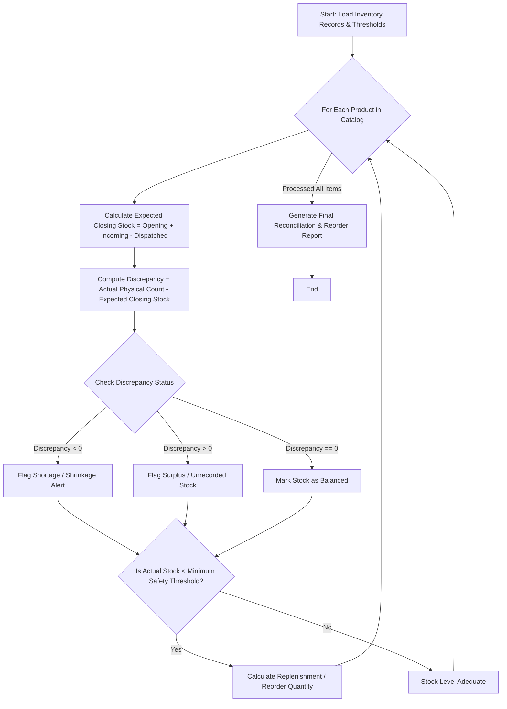

Here is the complete system design, algorithm, Mermaid flowchart, and Python implementation for the **Warehouse Inventory Reconciliation System**.

---

### 1. Problem Statement

Warehouse inventory management requires continuous auditing to ensure physical stock matches recorded book stock. Discrepancies often arise due to shrinkage, unrecorded damages, theft, or miscounts.

The **Warehouse Inventory Reconciliation System** automates inventory audits across multiple products by:

1. Reconciling inventory using the standard accounting equation:
$\text{Expected Closing Stock} = \text{Opening Stock} + \text{Incoming Quantities} - \text{Dispatched Quantities}$
2. Comparing the **Expected Closing Stock** against the **Actual Physical Count** to detect discrepancies (surplus or shortage).
3. Automatically calculating **Replenishment Requirements** whenever the actual stock falls below a predefined safety stock threshold.

---

### 2. Algorithm

1. **Initialize Parameters**: Set global safety stock thresholds or product-specific minimum stock limits.
2. **Input Inventory Records**: Receive a dataset containing product IDs, names, opening stock, incoming shipments, dispatched quantities, actual physical stock counts, and minimum safety stock limits.
3. **Perform Reconciliation for Each Product**:
* Compute expected closing stock: $\text{Expected} = \text{Opening} + \text{Incoming} - \text{Dispatched}$
* Compute discrepancy: $\text{Discrepancy} = \text{Actual Physical Count} - \text{Expected Closing Stock}$
* If Discrepancy $< 0$: Flag as **Stock Shortage (Shrinkage/Loss)**.
* If Discrepancy $> 0$: Flag as **Stock Surplus (Unrecorded Addition)**.
* If Discrepancy $= 0$: Mark as **Balanced / Matched**.


4. **Evaluate Replenishment Needs**:
* Check if $\text{Actual Physical Stock} < \text{Minimum Safety Stock}$.
* If true, calculate required reorder quantity: $\text{Reorder Quantity} = \text{Target Maximum Stock} - \text{Actual Physical Stock}$ (or a fixed replenishment batch size).


5. **Output Results**: Generate an audit reconciliation report highlighting discrepancies and reorder purchase orders.

---

### 3. Flowchart (Mermaid)



---

### 4. Python Source Code

```python
class WarehouseReconciliationSystem:

    def __init__(self, default_safety_buffer=20, default_target_stock=100):
        self.default_safety_buffer = default_safety_buffer
        self.default_target_stock = default_target_stock

    def reconcile_inventory(self, inventory_records):
        reconciliation_results = []
        replenishment_orders = []

        for item in inventory_records:
            prod_id = item["product_id"]
            name = item["name"]
            opening = item["opening_stock"]
            incoming = item["incoming"]
            dispatched = item["dispatched"]
            actual_physical = item["actual_physical_stock"]
            min_safety = item.get("min_safety_stock", self.default_safety_buffer)
            target_stock = item.get("target_stock", self.default_target_stock)

            # 1. Calculate Expected Closing Stock
            expected_closing = opening + incoming - dispatched

            # 2. Compute Discrepancy (Actual vs Expected)
            discrepancy = actual_physical - expected_closing

            if discrepancy < 0:
                status = f"⚠️ SHORTAGE ({abs(discrepancy)} units missing)"
            elif discrepancy > 0:
                status = f"➕ SURPLUS (+{discrepancy} unrecorded units)"
            else:
                status = "✅ Balanced (Matched perfectly)"

            # 3. Evaluate Replenishment Needs
            reorder_qty = 0
            needs_reorder = False
            if actual_physical < min_safety:
                needs_reorder = True
                reorder_qty = max(0, target_stock - actual_physical)
                replenishment_orders.append({
                    "product_id": prod_id,
                    "name": name,
                    "current_stock": actual_physical,
                    "suggested_reorder_qty": reorder_qty,
                })

            reconciliation_results.append({
                "product_id": prod_id,
                "name": name,
                "opening_stock": opening,
                "incoming": incoming,
                "dispatched": dispatched,
                "expected_closing": expected_closing,
                "actual_physical_stock": actual_physical,
                "discrepancy": discrepancy,
                "audit_status": status,
                "needs_replenishment": needs_reorder,
                "reorder_quantity": reorder_qty,
            })

        return reconciliation_results, replenishment_orders


# --- Sample Execution ---
if __name__ == "__main__":
    warehouse_system = WarehouseReconciliationSystem()

    # Sample inventory data across multiple warehouse SKUs
    warehouse_inventory = [
        {
            "product_id": "SKU-101",
            "name": "Wireless Ergonomic Mouse",
            "opening_stock": 150,
            "incoming": 200,
            "dispatched": 280,
            "actual_physical_stock": 68,  # Expected: 150+200-280 = 70 (-2 discrepancy)
            "min_safety_stock": 50,
            "target_stock": 150,
        },
        {
            "product_id": "SKU-102",
            "name": "Mechanical Gaming Keyboard",
            "opening_stock": 80,
            "incoming": 50,
            "dispatched": 110,
            "actual_physical_stock": 20,  # Expected: 80+50-110 = 20 (Balanced)
            "min_safety_stock": 30,  # Falls below safety stock -> Needs replenishment
            "target_stock": 100,
        },
        {
            "product_id": "SKU-103",
            "name": "UltraWide 4K Monitor 27-inch",
            "opening_stock": 45,
            "incoming": 30,
            "dispatched": 35,
            "actual_physical_stock": 42,  # Expected: 45+30-35 = 40 (+2 surplus)
            "min_safety_stock": 15,
            "target_stock": 60,
        },
        {
            "product_id": "SKU-104",
            "name": "USB-C Multiport Hub",
            "opening_stock": 300,
            "incoming": 100,
            "dispatched": 395,
            "actual_physical_stock": 3,  # Expected: 300+100-395 = 5 (-2 shortage)
            "min_safety_stock": 25,  # Critical low stock -> Reorder required
            "target_stock": 200,
        },
    ]

    report, purchase_orders = warehouse_system.reconcile_inventory(warehouse_inventory)

    print("=== WAREHOUSE INVENTORY RECONCILIATION REPORT ===")
    for item in report:
        print(f"\nProduct: {item['name']} ({item['product_id']})")
        print(f"  - Opening: {item['opening_stock']} | Incoming: +{item['incoming']} | Dispatched: -{item['dispatched']}")
        print(f"  - Expected Closing: {item['expected_closing']} | Physical Count: {item['actual_physical_stock']}")
        print(f"  - Discrepancy Status: {item['audit_status']}")
        if item["needs_replenishment"]:
            print(f"  ⚠️ REPLENISHMENT ALERT: Stock below safety threshold! Suggested Order: {item['reorder_quantity']} units")

    print("\n--- GENERATED PURCHASE ORDERS (REPLENISHMENT LIST) ---")
    if purchase_orders:
        for po in purchase_orders:
            print(f"• Reorder {po['suggested_reorder_qty']} units of {po['name']} ({po['product_id']})")
    else:
        print("No replenishment orders required at this time.")

```

---

### 5. Sample Input

```python
warehouse_inventory = [
    {
        "product_id": "SKU-101",
        "name": "Wireless Ergonomic Mouse",
        "opening_stock": 150,
        "incoming": 200,
        "dispatched": 280,
        "actual_physical_stock": 68,
        "min_safety_stock": 50,
        "target_stock": 150,
    },
    {
        "product_id": "SKU-102",
        "name": "Mechanical Gaming Keyboard",
        "opening_stock": 80,
        "incoming": 50,
        "dispatched": 110,
        "actual_physical_stock": 20,
        "min_safety_stock": 30,
        "target_stock": 100,
    },
    {
        "product_id": "SKU-103",
        "name": "UltraWide 4K Monitor 27-inch",
        "opening_stock": 45,
        "incoming": 30,
        "dispatched": 35,
        "actual_physical_stock": 42,
        "min_safety_stock": 15,
        "target_stock": 60,
    },
    {
        "product_id": "SKU-104",
        "name": "USB-C Multiport Hub",
        "opening_stock": 300,
        "incoming": 100,
        "dispatched": 395,
        "actual_physical_stock": 3,
        "min_safety_stock": 25,
        "target_stock": 200,
    },
]

```

---

### 6. Sample Output

```text
=== WAREHOUSE INVENTORY RECONCILIATION REPORT ===

Product: Wireless Ergonomic Mouse (SKU-101)
  - Opening: 150 | Incoming: +200 | Dispatched: -280
  - Expected Closing: 70 | Physical Count: 68
  - Discrepancy Status: ⚠️ SHORTAGE (2 units missing)

Product: Mechanical Gaming Keyboard (SKU-102)
  - Opening: 80 | Incoming: +50 | Dispatched: -110
  - Expected Closing: 20 | Physical Count: 20
  - Discrepancy Status: ✅ Balanced (Matched perfectly)
  ⚠️ REPLENISHMENT ALERT: Stock below safety threshold! Suggested Order: 80 units

Product: UltraWide 4K Monitor 27-inch (SKU-103)
  - Opening: 45 | Incoming: +30 | Dispatched: -35
  - Expected Closing: 40 | Physical Count: 42
  - Discrepancy Status: ➕ SURPLUS (+2 unrecorded units)

Product: USB-C Multiport Hub (SKU-104)
  - Opening: 300 | Incoming: +100 | Dispatched: -395
  - Expected Closing: 5 | Physical Count: 3
  - Discrepancy Status: ⚠️ SHORTAGE (2 units missing)
  ⚠️ REPLENISHMENT ALERT: Stock below safety threshold! Suggested Order: 197 units

--- GENERATED PURCHASE ORDERS (REPLENISHMENT LIST) ---
• Reorder 80 units of Mechanical Gaming Keyboard (SKU-102)
• Reorder 197 units of USB-C Multiport Hub (SKU-104)

```

---
